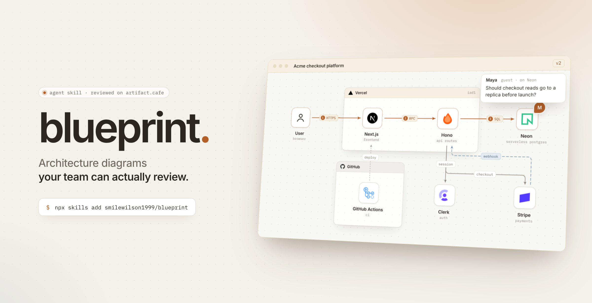
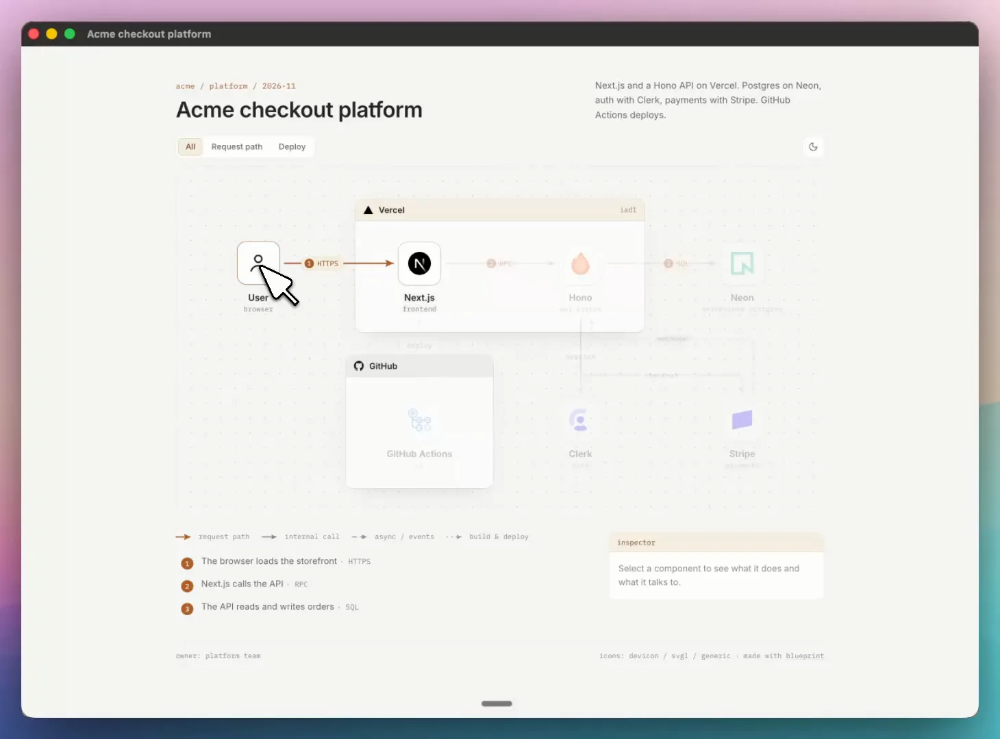
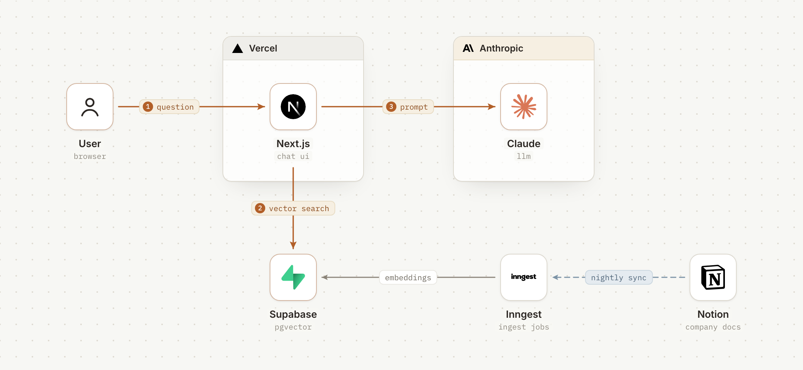
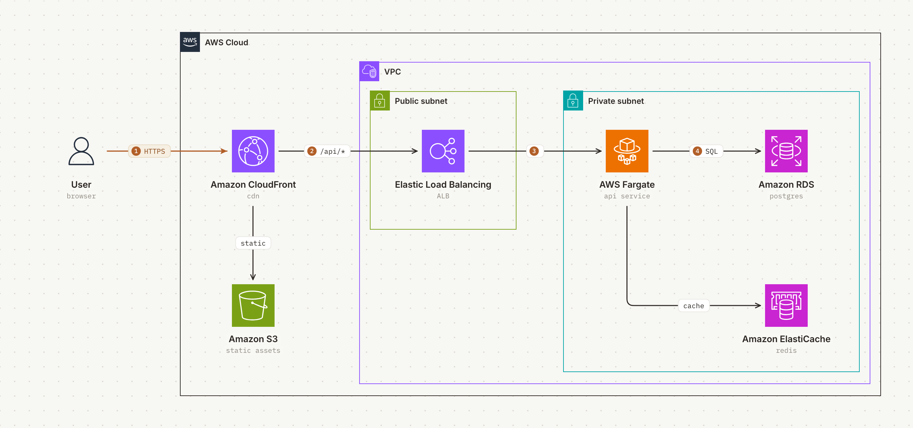
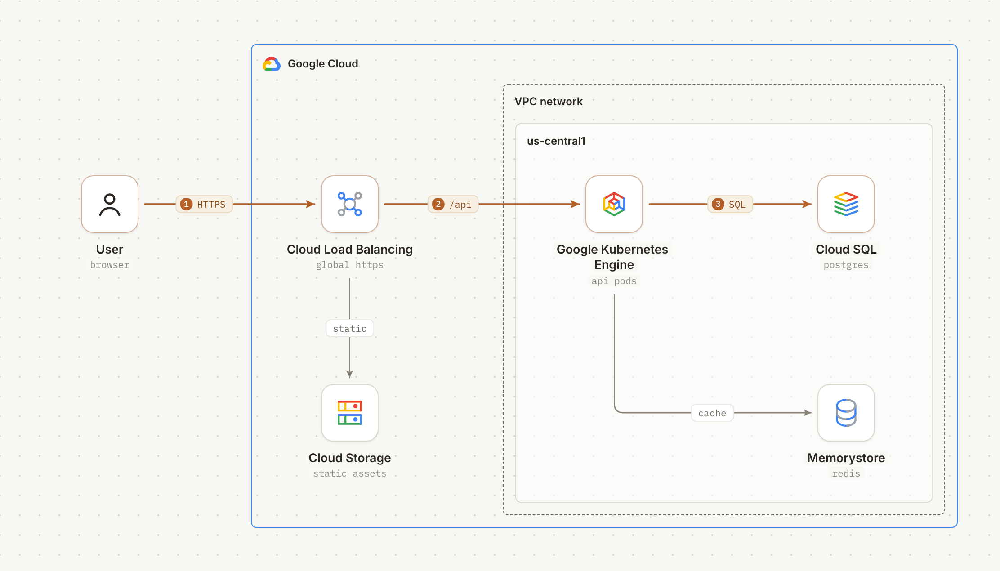
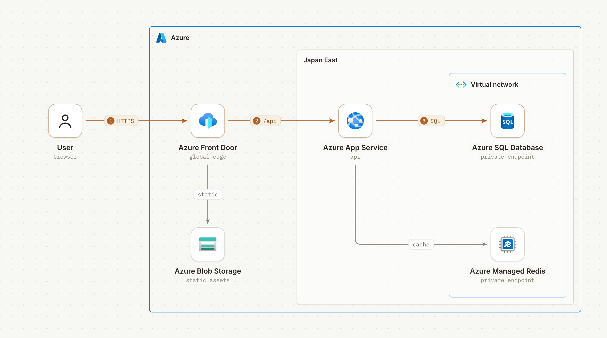
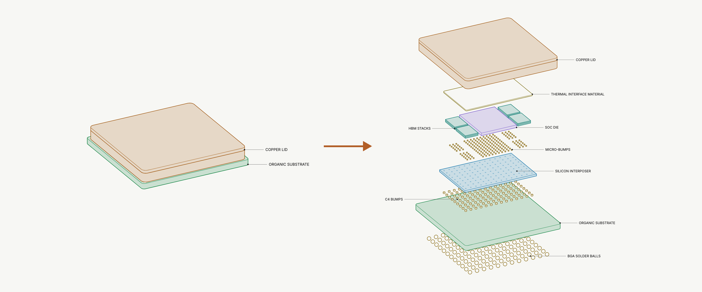
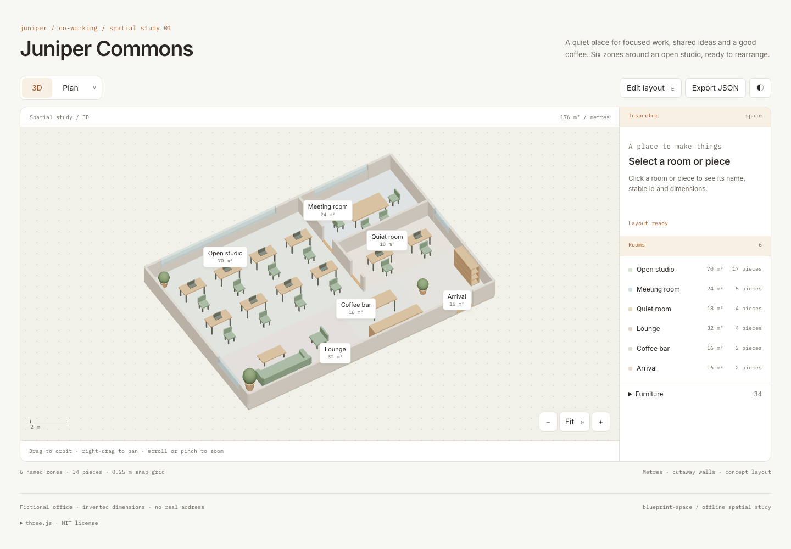
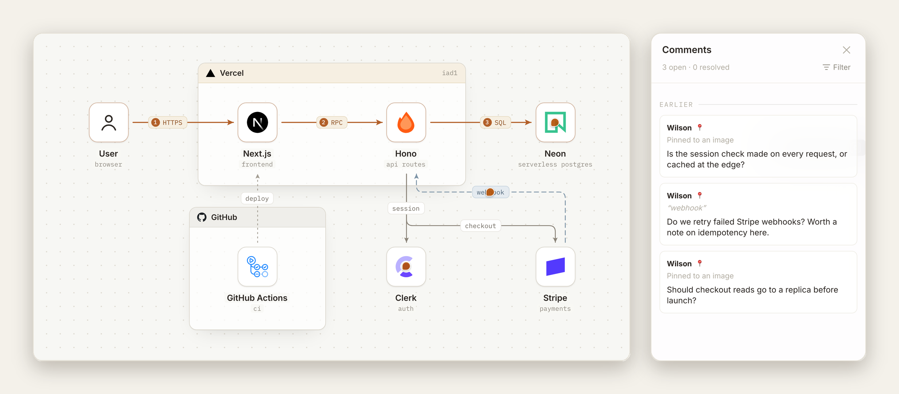
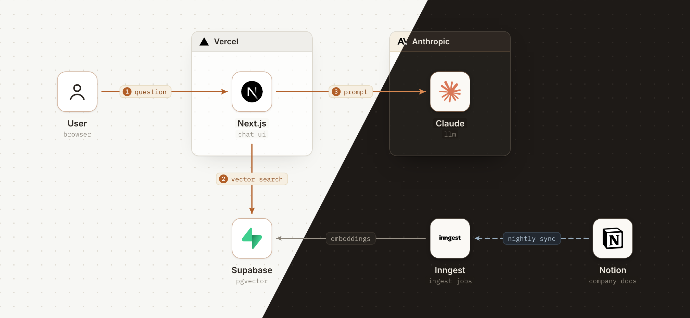

<picture>
  <source media="(prefers-color-scheme: dark)" srcset="docs/cover-dark.png">
  
</picture>

<div align="center">

作っているものを一文で伝えるだけ。エージェントがインタラクティブなページに描き、<br>チームは artifact.cafe でそのままレビューできます。アカウントは不要です。

[](https://github.com/smilewilson1999/blueprint/releases/latest) [](LICENSE) [](https://agentskills.io) [](https://artifact.cafe)

[English](README.md) · [繁體中文](README.zh-TW.md) · **日本語**

</div>

## 三つの skill

| Skill | 描くもの |
| --- | --- |
| **blueprint** | ソフトウェア構成：サービス、リクエスト経路、クラウドインフラ |
| **blueprint-teardown** | 物理的なものの分解図：チップパッケージ、基板、デバイス |
| **blueprint-space** | 物理空間：オフィス、平面図、部屋、編集できる家具配置 |

```bash
npx skills add smilewilson1999/blueprint --skill blueprint
npx skills add smilewilson1999/blueprint --skill blueprint-teardown
npx skills add smilewilson1999/blueprint --skill blueprint-space
```

Claude Code、Codex、Cursor など、[skills に対応したエージェント](https://agentskills.io)で使えます。Claude アプリでは [Releases](https://github.com/smilewilson1999/blueprint/releases/latest) から該当する zip をアップロードしてください。あとはこう頼むだけです：

> *「うちのスタックを図にして。Next.js と Hono の API を Vercel で、Postgres は Neon、認証は Clerk、決済は Stripe。」*

**そのまま試せます：**[チェックアウト構成図](https://artifact.cafe/a/acme-checkout-platform-vb1hn0) · [CoWoS 分解図](https://artifact.cafe/a/cowos-package-teardown-9wbulc)。アカウント不要で、ズーム、部品のクリック、コメントができます。

## blueprint



- **たどるべき経路は一本。** リクエスト経路はアンバーで番号付き、図の下に平易なステップ一覧が並びます。
- **フローを切り替えられる。** リクエスト経路、夜間同期、デプロイ。タブを選ぶとその線だけが光り、ほかは薄くなります。
- **すべての部品にインスペクタ。** カーソルで接続先を、クリックで役割・メモ・リンクを表示します。
- **デザインツールのようにズーム。** ホイールを上でズームイン、下でズームアウト、カーソルを中心に。空白をドラッグで移動。スマートフォンでは二本指でピンチ。
- **座標計算は不要。** エージェントは短い [`blueprint.json`](skills/blueprint/references/spec.md) を書くだけ。ビルドがレイアウトと配線を行い、重なりはあなたが見る前にすべて検出します。

## ギャラリー

<table>
  <tr>
    <td width="50%" valign="top">
      <picture>
        <source media="(prefers-color-scheme: dark)" srcset="docs/ai-dark.png">
        
      </picture>
      <p><b>AI アプリ</b><br><sub>Next.js、Supabase pgvector、Claude と Notion の夜間同期。</sub></p>
    </td>
    <td width="50%" valign="top">
      <picture>
        <source media="(prefers-color-scheme: dark)" srcset="docs/aws-dark.png">
        
      </picture>
      <p><b>AWS</b><br><sub>サブネット、VPC、サービスアイコンを AWS 自身の描き方で。</sub></p>
    </td>
  </tr>
  <tr>
    <td width="50%" valign="top">
      <picture>
        <source media="(prefers-color-scheme: dark)" srcset="docs/gcp-dark.png">
        
      </picture>
      <p><b>Google Cloud</b><br><sub>リージョンは VPC の中に、グローバルなサービスはその外に。</sub></p>
    </td>
    <td width="50%" valign="top">
      <picture>
        <source media="(prefers-color-scheme: dark)" srcset="docs/azure-dark.png">
        
      </picture>
      <p><b>Azure</b><br><sub>VNet 内の private endpoint。サービス名は Microsoft の求めるとおり正式名称で。</sub></p>
    </td>
  </tr>
  <tr>
    <td colspan="2" valign="top">
      <picture>
        <source media="(prefers-color-scheme: dark)" srcset="docs/teardown-gallery-dark.png">
        
      </picture>
      <p><b>チップパッケージ（blueprint-teardown）</b><br><sub>CoWoS 型パッケージの組立図と分解図。HBM スタック数と DRAM 層数はスライダーで変えられ、SVG・PNG・PDF をダウンロードできます。寸法を創作したコンセプト図です。</sub></p>
    </td>
  </tr>
  <tr>
    <td colspan="2" valign="top">
      <picture>
        <source media="(prefers-color-scheme: dark)" srcset="docs/space-dark.png">
        
      </picture>
      <p><b>配置を変えられる空間（blueprint-space）</b><br><sub>架空のコワーキングオフィス Juniper Commons。3Dで回転し、平面図に切り替え、部屋や家具を選択。家具をグリッドに沿って移動・回転し、space.json に書き出して再ビルドできます。オフラインで動作します。</sub></p>
    </td>
  </tr>
</table>

## artifact.cafe でレビュー

三つの skill はいずれも自己完結した HTML ファイルを一つ作ります。エージェントが [artifact.cafe](https://artifact.cafe) に公開してリンクを渡し、レビュアーはアカウントなしで、部品・ラベル・テキストのどこにでもコメントできます。設計が変われば、エージェントが新しい版を公開し、各スレッドに返信します。



## その他

<details>
<summary><b>ライトとダーク</b></summary>
<br>

どの図もライトとダークの両方のテーマを持ち、読み手のシステム設定に合わせて切り替わります。構成図のタイルは明るいままなので、各ロゴは本来の色を保ちます。


</details>

<details>
<summary><b>公式ロゴだけ、描き直さない</b></summary>
<br>

ロゴは [svgl](https://svgl.app)、[devicon](https://devicon.dev)、[gilbarbara/logos](https://github.com/gilbarbara/logos)、またはブランド自身のリポジトリから取得し、[AWS](https://aws.amazon.com/architecture/icons/)、[Google Cloud](https://cloud.google.com/icons)、[Azure](https://learn.microsoft.com/en-us/azure/architecture/icons/) は各社公式のアイコンパッケージを使います。キューや cron のような概念には [Lucide](https://lucide.dev) のピクトグラムを。ロゴの色は変えません。明るいタイルで見えなくなるなら、暗いタイルに載せます。
</details>

<details>
<summary><b>サンプルを動かす</b></summary>
<br>

blueprint には Python 3.9 以上と、ロゴ取得のためのネットワーク接続が必要です：

```bash
cd examples/saas
python3 ../../skills/blueprint/scripts/fetch_icons.py icons vercel nextjs hono neon clerk stripe github "actions:githubactions"
cp ../../skills/blueprint/assets/generic/user.svg icons/
python3 ../../skills/blueprint/scripts/blueprint.py blueprint.json icons index.html
```

blueprint-teardown には Node 22 以上が必要です：

```bash
cd examples/cowos
npm install && npm run build    # dist/index.html
npm run film                    # 任意：デモ動画。Python Playwright と ffmpeg が必要
```

blueprint-space には Python 3.9 以上が必要で、オフラインでビルドできます。PNG とブラウザの検証には Python Playwright と Chromium も必要です：

```bash
cd examples/juniper-commons
python3 ../../skills/blueprint-space/scripts/space.py space.json dist/index.html --strict
python3 ../../skills/blueprint-space/scripts/check_space.py dist/index.html check/
python3 ../../skills/blueprint-space/scripts/render_png.py dist/index.html space.png --view both
```

生成された `dist/` には `index.html` だけを置き、`check/` と PNG は外に置き、artifact.cafe には `dist/` だけを公開します。

PNG の書き出しと proof には Playwright と Chromium を使います。
</details>

## クレジットとライセンス

blueprint は caru-ini による [stack-diagram](https://github.com/caru-ini/stack-diagram) のフォークとして始まり、そのアイコン取得の仕組みとクラウドベンダーごとの描画ルールを引き継いでいます。blueprint-teardown の描画エンジンは Jakub Krehel による [teardown](https://github.com/jakubkrehel/skills/tree/main/skills/teardown) で、加えた変更は [`engine/PATCHES.md`](skills/blueprint-teardown/engine/PATCHES.md) にあります。

- コードとドキュメント：MIT。[`LICENSE`](LICENSE) を参照。
- `skills/blueprint-teardown/engine/` の teardown エンジン：MIT、Copyright (c) 2026 Jakub Krehel。[`engine/LICENSE`](skills/blueprint-teardown/engine/LICENSE) を参照。
- `skills/blueprint-space/assets/vendor/` に同梱した three.js **0.170.0**：MIT。[`vendor/LICENSE`](skills/blueprint-space/assets/vendor/LICENSE) と [`vendor/PATCHES.md`](skills/blueprint-space/assets/vendor/PATCHES.md) を参照。
- 同梱フォント（Inter、IBM Plex Mono）：SIL Open Font License 1.1。[`assets/fonts`](skills/blueprint/assets/fonts) を参照。
- 空間用 skill も同じ OFL フォントを [`blueprint-space/assets/fonts`](skills/blueprint-space/assets/fonts) に同梱しています。
- ロゴは同梱して**いません**。ビルド時に上記の提供元からダウンロードします。`docs/` の画像には第三者のロゴが含まれます。ブランド名とロゴはすべて各所有者の商標であり、図での使用は推奨や提携を意味しません。
