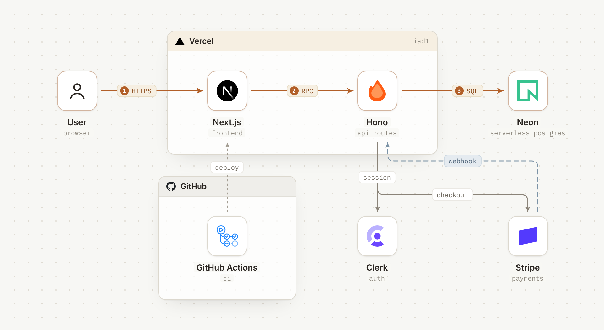
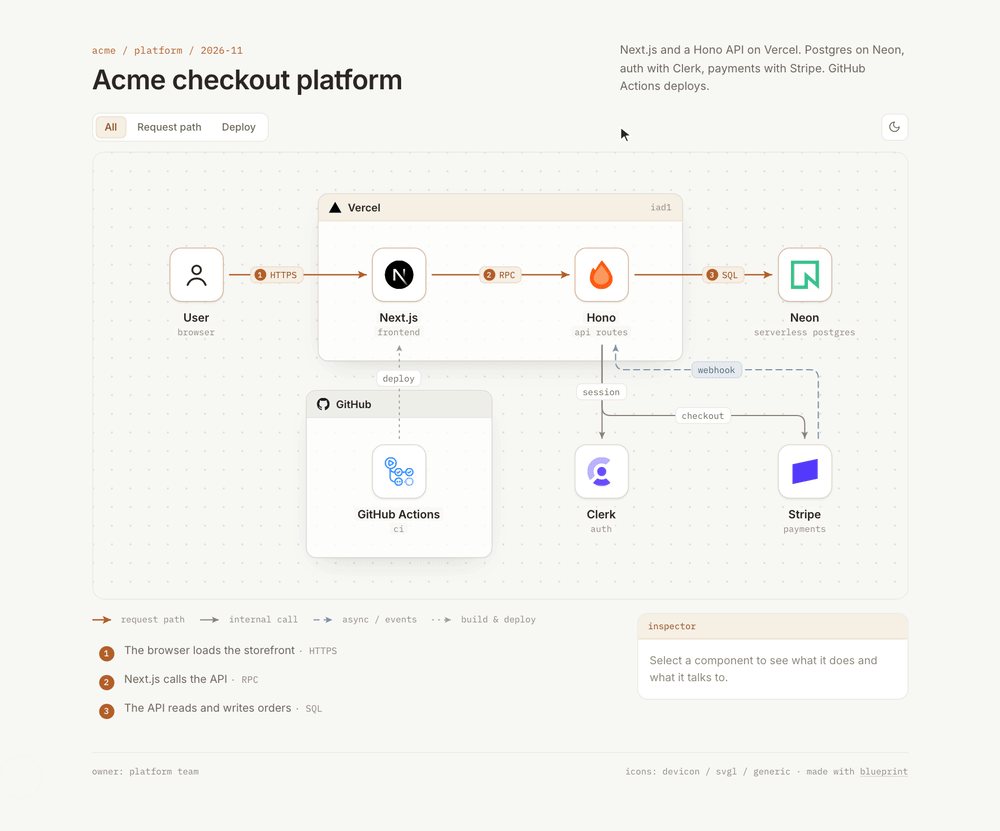
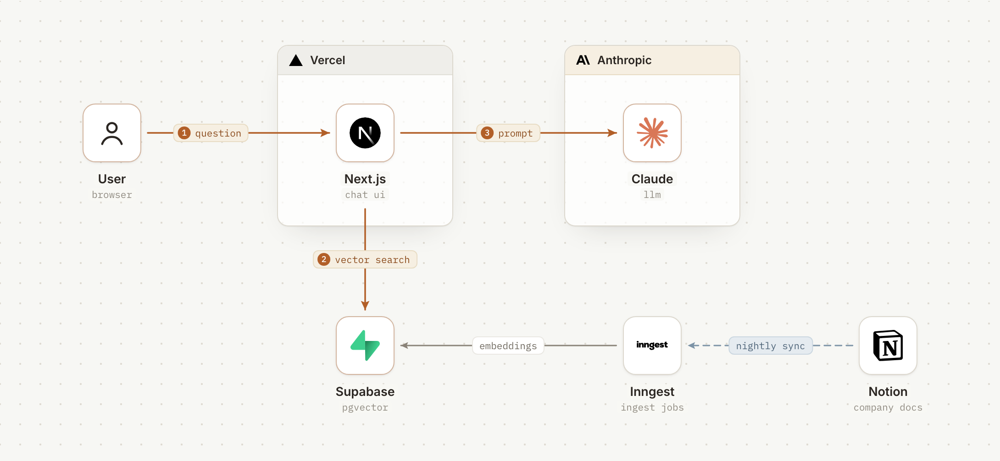
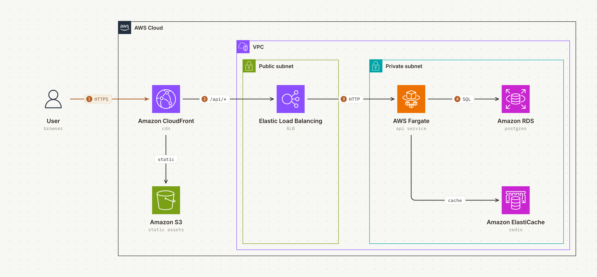
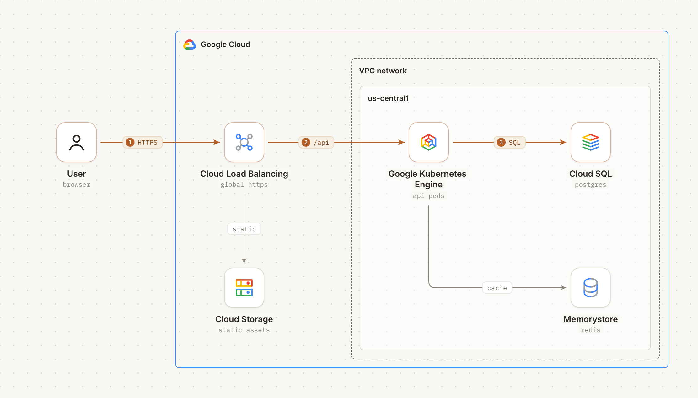
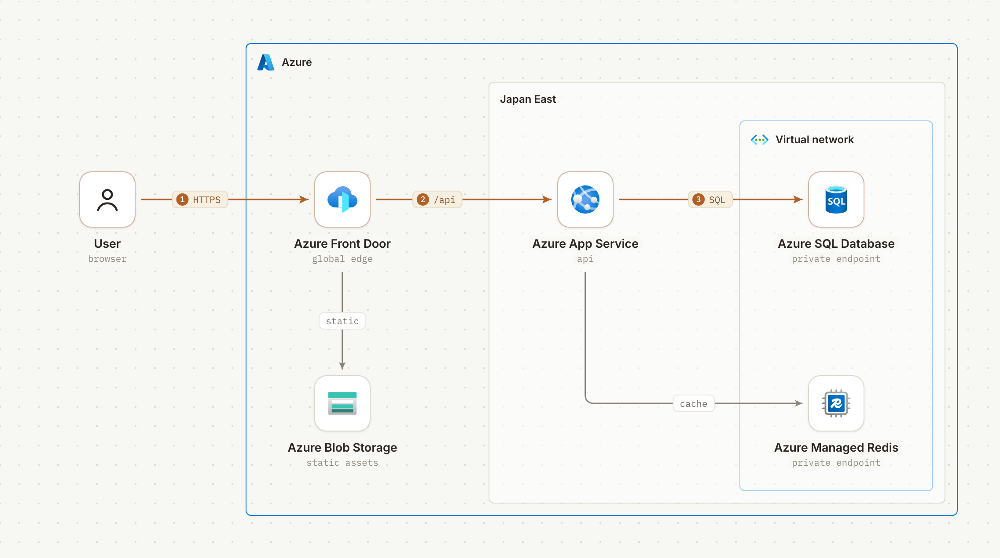
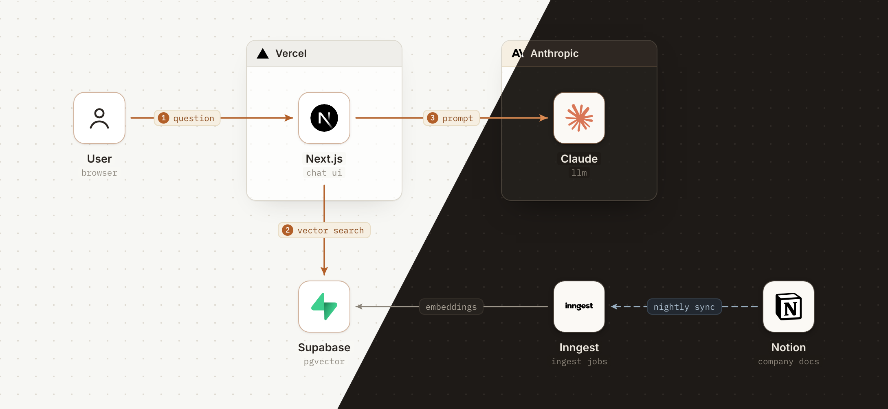

<div align="center">

# blueprint

**Architecture diagrams your team can actually review.**

Describe your stack in a sentence. Your agent draws it with official logos, one clear request path,<br>and an interactive page that reviewers can comment on.

[](LICENSE) [](https://agentskills.io) [](https://artifact.cafe)

**English** · [繁體中文](README.zh-TW.md) · [日本語](README.ja.md)

</div>

<br>

<picture>
  <source media="(prefers-color-scheme: dark)" srcset="docs/hero-dark.png">
  
</picture>

<p align="center"><sub><i>"Diagram our stack: Next.js and a Hono API on Vercel. Postgres on Neon, auth with Clerk, payments with Stripe. GitHub Actions deploys."</i></sub></p>

## Install

```bash
npx skills add smilewilson1999/blueprint
```

Works with Claude Code, Codex, Cursor and [any agent that supports skills](https://agentskills.io). Then just ask for a diagram.

## It's a page, not a picture



<table>
  <tr>
    <td width="50%" valign="top">
      <h3>One path to follow</h3>
      The request path is amber and numbered, with a plain-language step list under the diagram. Everything else steps back.
    </td>
    <td width="50%" valign="top">
      <h3>Flows you can switch</h3>
      Request path, nightly sync, deploy. Each flow gets its own tab that lights up its edges and quietly dims the rest.
    </td>
  </tr>
  <tr>
    <td width="50%" valign="top">
      <h3>An inspector for every part</h3>
      Hover a component to see what it talks to. Click it for its role, why it's there, and a link to its repo.
    </td>
    <td width="50%" valign="top">
      <h3>Built to be commented on</h3>
      Names, roles and labels are real text with stable ids, so feedback pins to its component and stays across versions.
    </td>
  </tr>
</table>

## How it works

**1. Your agent describes the system.** No coordinates, no pixel math. Nodes sit on a grid, groups list their members, edges name their ends.

```json
{
  "groups": [{ "id": "vercel", "label": "Vercel", "icon": "vercel", "contains": ["next", "hono"] }],
  "nodes": [
    { "id": "next", "name": "Next.js", "role": "frontend", "icon": "nextjs", "at": [1, 0] },
    { "id": "hono", "name": "Hono", "role": "api routes", "icon": "hono", "at": [2, 0] }
  ],
  "edges": [{ "from": "next", "to": "hono", "label": "RPC", "kind": "primary", "step": 2 }]
}
```

**2. The build does the drawing.** It sizes every group from its members, routes edges around nodes and labels, gives two-way pairs their own lanes, and flags every overlap it finds, so the agent fixes problems before you ever see them.

**3. You review it on artifact.cafe.** The result is one self-contained HTML file. Your agent publishes it to [artifact.cafe](https://artifact.cafe) and hands you a link. Reviewers comment without an account; when the architecture changes, the agent publishes the next version and earlier comments stay attached to the parts they were about.

Need a static image? Every diagram also renders to light and dark PNGs for Slack, slides and READMEs.

## Gallery

<table>
  <tr>
    <td width="50%" valign="top">
      <picture>
        <source media="(prefers-color-scheme: dark)" srcset="docs/ai-dark.png">
        
      </picture>
      <p><b>AI apps</b><br><sub>Docs chatbot: Next.js, Supabase pgvector, Claude, and a nightly Notion sync on Inngest.</sub></p>
    </td>
    <td width="50%" valign="top">
      <picture>
        <source media="(prefers-color-scheme: dark)" srcset="docs/aws-dark.png">
        
      </picture>
      <p><b>AWS, with AWS's own icons</b><br><sub>Subnets, VPC and service icons drawn the way AWS draws them.</sub></p>
    </td>
  </tr>
  <tr>
    <td width="50%" valign="top">
      <picture>
        <source media="(prefers-color-scheme: dark)" srcset="docs/gcp-dark.png">
        
      </picture>
      <p><b>Google Cloud, with Google's own icons</b><br><sub>Regions inside the VPC, global services outside it.</sub></p>
    </td>
    <td width="50%" valign="top">
      <picture>
        <source media="(prefers-color-scheme: dark)" srcset="docs/azure-dark.png">
        
      </picture>
      <p><b>Azure, with Microsoft's own icons</b><br><sub>Private endpoints in a VNet, full service names as Microsoft asks.</sub></p>
    </td>
  </tr>
</table>

## Light and dark

Every diagram ships with both themes and follows the reader's system setting. Tiles stay light so each logo keeps its own colors, and group marks switch to the brand's dark-theme version.



## Official logos, never redrawn

Logos come from [svgl](https://svgl.app), [devicon](https://devicon.dev), [gilbarbara/logos](https://github.com/gilbarbara/logos) or the brand's own repository, and from each vendor's own package for [AWS](https://aws.amazon.com/architecture/icons/), [Google Cloud](https://cloud.google.com/icons) and [Azure](https://learn.microsoft.com/en-us/azure/architecture/icons/). Concepts like a queue or a cron job get a [Lucide](https://lucide.dev) pictogram. A logo is never recolored: if it would vanish on a light tile, it goes on a dark one.

## Try an example

```bash
cd examples/saas
python3 ../../skills/blueprint/scripts/fetch_icons.py icons vercel nextjs hono neon clerk stripe github "actions:githubactions"
cp ../../skills/blueprint/assets/generic/user.svg icons/
python3 ../../skills/blueprint/scripts/blueprint.py blueprint.json icons index.html
open index.html
```

Requires Python 3.9+ and network access for the logos. PNG export uses Playwright with Chromium. The full spec format is in [`references/spec.md`](skills/blueprint/references/spec.md).

## Credits and licenses

blueprint started as a fork of [stack-diagram](https://github.com/caru-ini/stack-diagram) by caru-ini, whose icon pipeline and vendor rules it keeps.

- Code and docs: MIT, see [`LICENSE`](LICENSE).
- Bundled fonts (Inter, IBM Plex Mono): SIL Open Font License 1.1, see [`assets/fonts`](skills/blueprint/assets/fonts).
- Logos are **not** bundled. They are downloaded at build time from the sources above. The images in `docs/` show third-party logos. All brand names and logos are trademarks of their respective owners; their use in a diagram does not imply endorsement.
