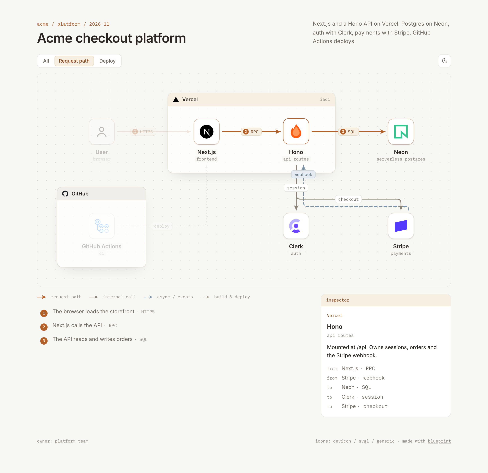

# blueprint

Describe your stack in a sentence. Get an interactive architecture diagram your team can review.

<picture>
  <source media="(prefers-color-scheme: dark)" srcset="docs/hero-dark.png">
  
</picture>

> Diagram our stack: Next.js and a Hono API on Vercel. Postgres on Neon, auth with Clerk, payments with Stripe. GitHub Actions deploys.

```bash
npx skills add smilewilson1999/blueprint
```

Works with Claude Code, Codex, Cursor and [other agents that support skills](https://agentskills.io).

## What's different

blueprint is a fork of [stack-diagram](https://github.com/caru-ini/stack-diagram) by caru-ini, rebuilt around review:

- **You describe, it lays out.** The agent writes a short `blueprint.json` (nodes on a grid, groups by membership, edges by endpoints). The build computes every coordinate, sizes the groups, routes edges around nodes and labels, and reports any overlap it finds.
- **One path to follow.** The request path is amber and numbered, with a step list under the diagram. Everything else steps back.
- **Interactive.** Switch between flows (request path, deploy, nightly sync), hover a component to see what it talks to, click it for its role, notes and links.
- **Made for comments.** Every name, role and edge label is real text with a stable id, so feedback on [artifact.cafe](https://artifact.cafe) pins to the component it's about and stays there across versions.
- **Cafe OS look.** Warm paper, groups as small OS windows, Inter and IBM Plex Mono, light and dark themes.



## Publish it for review

The diagram is one HTML file with its fonts and logos inlined. The agent publishes it to artifact.cafe and hands you a link; reviewers comment without an account, and the agent publishes the next version when the architecture changes.

PNG export (light and dark) is there for Slack, slides and READMEs.

## Try the example

```bash
cd examples/saas
python3 ../../skills/blueprint/scripts/fetch_icons.py icons vercel nextjs hono neon clerk stripe github "actions:githubactions"
cp ../../skills/blueprint/assets/generic/user.svg icons/
python3 ../../skills/blueprint/scripts/blueprint.py blueprint.json icons index.html
```

Requires Python 3.9+ and network access for the logos. PNG export uses Playwright with Chromium.

## Logos

Official marks only, never recolored or redrawn: from [svgl](https://svgl.app), [devicon](https://devicon.dev), [gilbarbara/logos](https://github.com/gilbarbara/logos) or the brand's own repository, plus each vendor's own icon package for [AWS](https://aws.amazon.com/architecture/icons/), [Google Cloud](https://cloud.google.com/icons) and [Azure](https://learn.microsoft.com/en-us/azure/architecture/icons/), and [Lucide](https://lucide.dev) for concepts.

## Licenses and trademarks

- Code and docs: MIT, see `LICENSE`. Originally stack-diagram by caru-ini.
- Bundled fonts: SIL Open Font License 1.1, see `skills/blueprint/assets/fonts/`.
- Logos are **not** bundled. They are downloaded at build time from the sources above. The example images in `docs/` show third-party logos. All brand names and logos are trademarks of their respective owners; their use in a diagram does not imply endorsement.
