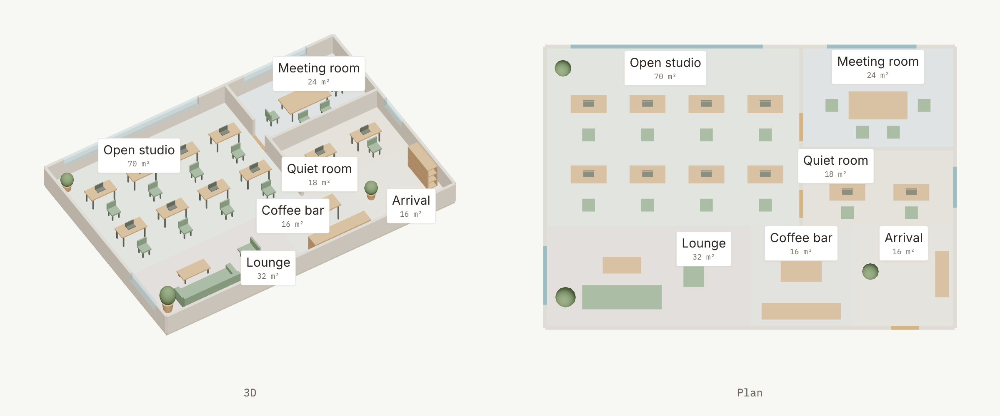

<picture>
  <source media="(prefers-color-scheme: dark)" srcset="docs/cover-dark.png">
  
</picture>

<div align="center">

Describe what you're building in a sentence. Your agent draws it as an interactive page,<br>and your team reviews it on artifact.cafe, no account needed.

[](https://github.com/smilewilson1999/blueprint/releases/latest) [](LICENSE) [](https://agentskills.io) [](https://artifact.cafe)

**English** · [繁體中文](README.zh-TW.md) · [日本語](README.ja.md)

</div>

## Three skills

| Skill | Draws |
| --- | --- |
| **blueprint** | Software architecture: services, request paths, cloud infrastructure |
| **blueprint-teardown** | Physical things, exploded: chip packages, boards, devices |
| **blueprint-space** | Physical spaces: offices, floor plans, rooms and editable furniture layouts |

```bash
npx skills add smilewilson1999/blueprint --skill blueprint
npx skills add smilewilson1999/blueprint --skill blueprint-teardown
npx skills add smilewilson1999/blueprint --skill blueprint-space
```

They work with Claude Code, Codex, Cursor and [any agent that supports skills](https://agentskills.io). In the Claude apps, upload the skill's zip from [Releases](https://github.com/smilewilson1999/blueprint/releases/latest). Then just ask:

> *"Diagram our stack: Next.js and a Hono API on Vercel, Postgres on Neon, auth with Clerk, payments with Stripe."*

**Try them live:** [checkout architecture](https://artifact.cafe/a/acme-checkout-platform-vb1hn0) · [CoWoS teardown](https://artifact.cafe/a/cowos-package-teardown-9wbulc). No account needed: zoom, click a part, leave a comment.

## blueprint


- **One path to follow.** The request path is amber and numbered, with a plain-language step list under the diagram.
- **Flows you can switch.** Request path, nightly sync, deploy: each tab lights up its own edges and dims the rest.
- **An inspector for every part.** Hover to see what a component talks to; click for its role, notes and links.
- **Zoom like a design canvas.** Scroll up to zoom in and down to zoom out, around the pointer; drag to pan. On a phone, pinch with two fingers.
- **No pixel math.** The agent writes a short [`blueprint.json`](skills/blueprint/references/spec.md); the build lays it out, routes every edge and flags any overlap before you see it.

## Gallery

<table>
  <tr>
    <td width="50%" valign="top">
      <picture>
        <source media="(prefers-color-scheme: dark)" srcset="docs/ai-dark.png">
        
      </picture>
      <p><b>AI apps</b><br><sub>Next.js, Supabase pgvector, Claude and a nightly Notion sync.</sub></p>
    </td>
    <td width="50%" valign="top">
      <picture>
        <source media="(prefers-color-scheme: dark)" srcset="docs/aws-dark.png">
        
      </picture>
      <p><b>AWS</b><br><sub>Subnets, VPC and service icons drawn the way AWS draws them.</sub></p>
    </td>
  </tr>
  <tr>
    <td width="50%" valign="top">
      <picture>
        <source media="(prefers-color-scheme: dark)" srcset="docs/gcp-dark.png">
        
      </picture>
      <p><b>Google Cloud</b><br><sub>Regions inside the VPC, global services outside it.</sub></p>
    </td>
    <td width="50%" valign="top">
      <picture>
        <source media="(prefers-color-scheme: dark)" srcset="docs/azure-dark.png">
        
      </picture>
      <p><b>Azure</b><br><sub>Private endpoints in a VNet, full service names as Microsoft asks.</sub></p>
    </td>
  </tr>
  <tr>
    <td colspan="2" valign="top">
      <picture>
        <source media="(prefers-color-scheme: dark)" srcset="docs/teardown-gallery-dark.png">
        
      </picture>
      <p><b>Chip package, with blueprint-teardown</b><br><sub>A CoWoS-style package, assembled and exploded. Sliders for HBM stacks and DRAM layers; SVG, PNG and PDF downloads. A concept with invented dimensions.</sub></p>
    </td>
  </tr>
  <tr>
    <td colspan="2" valign="top">
      <picture>
        <source media="(prefers-color-scheme: dark)" srcset="docs/space-gallery-dark.png">
        
      </picture>
      <p><b>A space to rearrange, with blueprint-space</b><br><sub>Juniper Commons, a fictional co-working office. Orbit in 3D, switch to Plan, inspect rooms and pieces, drag and rotate furniture on a grid, then export space.json to rebuild the layout. Works offline.</sub></p>
    </td>
  </tr>
</table>

## Review on artifact.cafe

All three skills produce one self-contained HTML file. Your agent publishes it to [artifact.cafe](https://artifact.cafe) and hands you a link. Reviewers click any part, label or text and leave a note, without an account. When the design changes, the agent publishes the next version and replies to each thread.


## More

<details>
<summary><b>Light and dark</b></summary>
<br>

Every diagram ships both themes and follows the reader's system setting. Architecture tiles stay light so each logo keeps its own colors.


</details>

<details>
<summary><b>Official logos, never redrawn</b></summary>
<br>

Logos come from [svgl](https://svgl.app), [devicon](https://devicon.dev), [gilbarbara/logos](https://github.com/gilbarbara/logos) or the brand's own repository, and from each vendor's own package for [AWS](https://aws.amazon.com/architecture/icons/), [Google Cloud](https://cloud.google.com/icons) and [Azure](https://learn.microsoft.com/en-us/azure/architecture/icons/). Concepts like a queue or a cron job get a [Lucide](https://lucide.dev) pictogram. A logo is never recolored: if it would vanish on a light tile, it goes on a dark one.
</details>

<details>
<summary><b>Run the examples</b></summary>
<br>

blueprint needs Python 3.9+ and network access for the logos:

```bash
cd examples/saas
python3 ../../skills/blueprint/scripts/fetch_icons.py icons vercel nextjs hono neon clerk stripe github "actions:githubactions"
cp ../../skills/blueprint/assets/generic/user.svg icons/
python3 ../../skills/blueprint/scripts/blueprint.py blueprint.json icons index.html
```

blueprint-teardown needs Node 22+:

```bash
cd examples/cowos
npm install && npm run build    # dist/index.html
npm run film                    # optional demo video; needs Python Playwright and ffmpeg
```

blueprint-space needs Python 3.9+ and builds offline. Rendering and browser checks also need Python Playwright with Chromium:

```bash
cd examples/juniper-commons
python3 ../../skills/blueprint-space/scripts/space.py space.json dist/index.html --strict
python3 ../../skills/blueprint-space/scripts/check_space.py dist/index.html check/
python3 ../../skills/blueprint-space/scripts/render_png.py dist/index.html space.png --view both
```

The generated `dist/` folder contains only `index.html`; keep `check/` and PNGs outside it and publish only `dist/` to artifact.cafe.

PNG export and proofs use Playwright with Chromium.
</details>

## Credits and licenses

blueprint started as a fork of [stack-diagram](https://github.com/caru-ini/stack-diagram) by caru-ini, whose icon pipeline and vendor rules it keeps. blueprint-teardown draws with [teardown](https://github.com/jakubkrehel/skills/tree/main/skills/teardown) by Jakub Krehel; its changes are listed in [`engine/PATCHES.md`](skills/blueprint-teardown/engine/PATCHES.md).

- Code and docs: MIT, see [`LICENSE`](LICENSE).
- The teardown engine in `skills/blueprint-teardown/engine/`: MIT, Copyright (c) 2026 Jakub Krehel, see [`engine/LICENSE`](skills/blueprint-teardown/engine/LICENSE).
- Vendored three.js **0.170.0** in `skills/blueprint-space/assets/vendor/`: MIT, see [`vendor/LICENSE`](skills/blueprint-space/assets/vendor/LICENSE) and [`vendor/PATCHES.md`](skills/blueprint-space/assets/vendor/PATCHES.md).
- Bundled fonts (Inter, IBM Plex Mono): SIL Open Font License 1.1, see [`assets/fonts`](skills/blueprint/assets/fonts).
- The space skill bundles the same OFL fonts under [`blueprint-space/assets/fonts`](skills/blueprint-space/assets/fonts).
- Logos are **not** bundled. They are downloaded at build time from the sources above. The images in `docs/` show third-party logos. All brand names and logos are trademarks of their respective owners; their use in a diagram does not imply endorsement.
