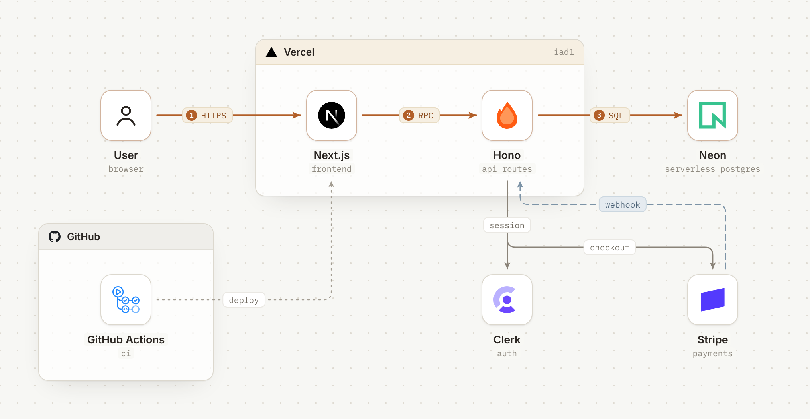
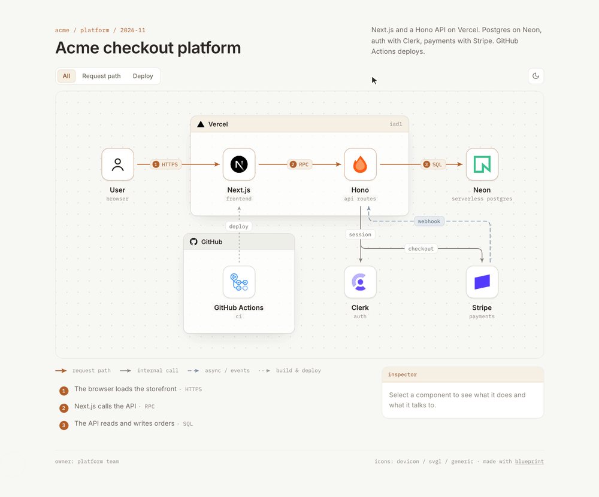
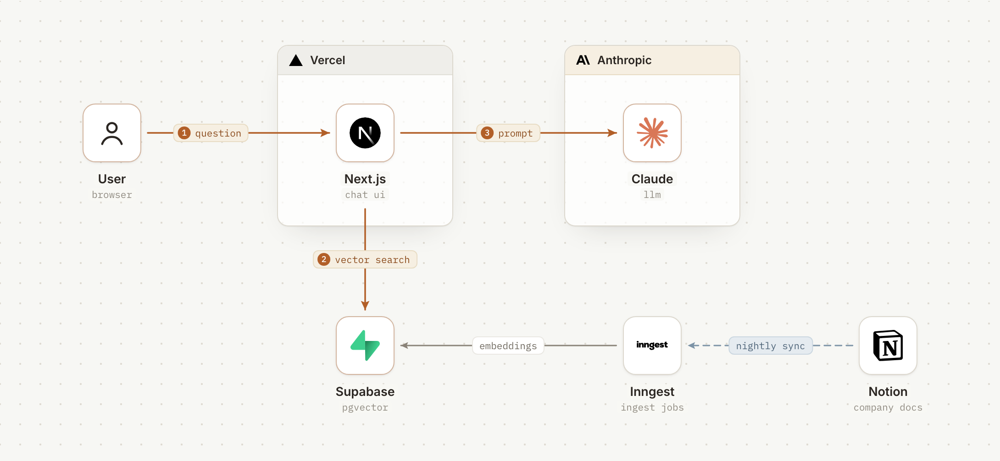
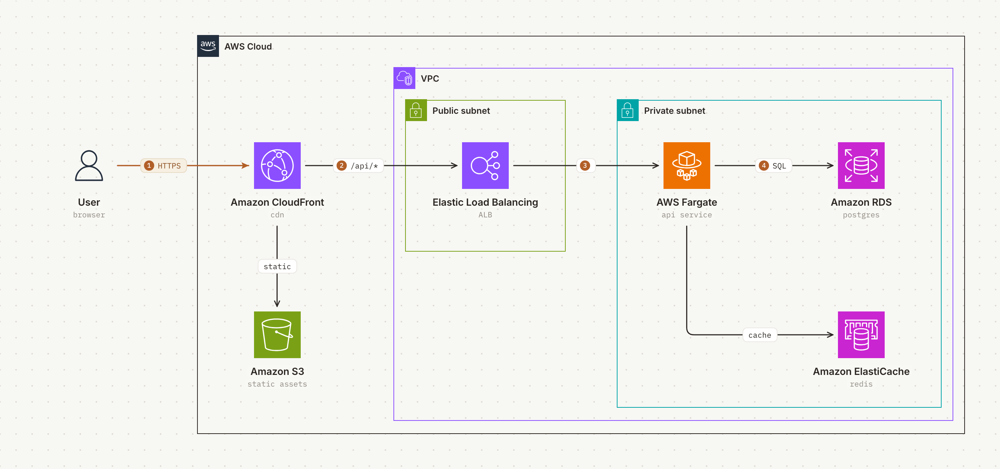
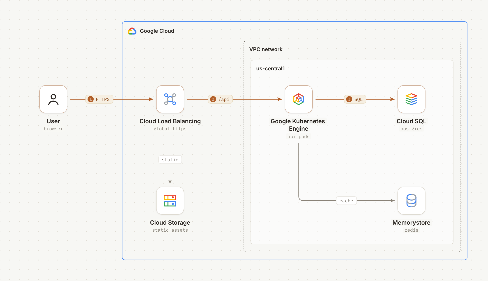
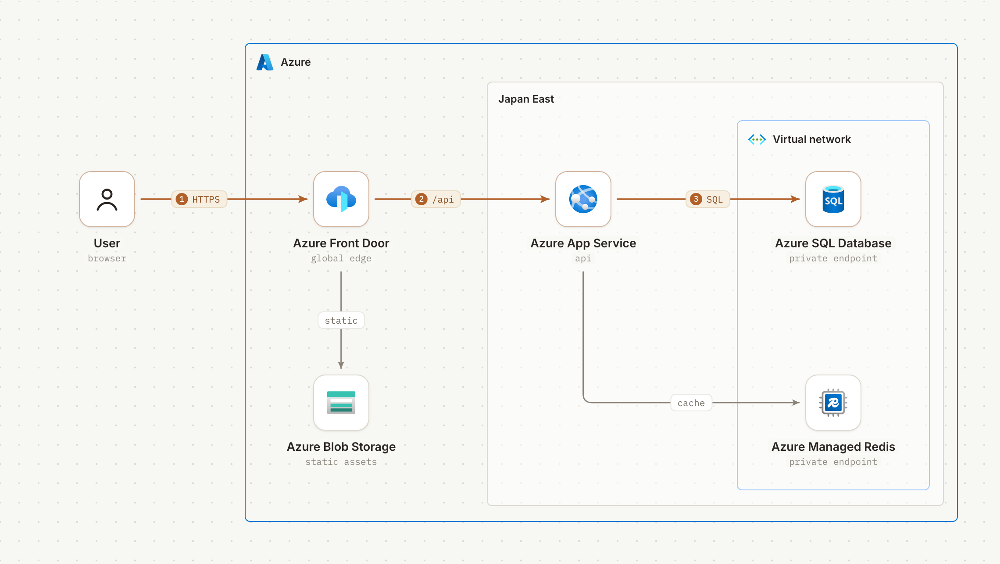

<div align="center">

# blueprint

**讓團隊真的能一起審的架構圖。**

用一句話描述你的技術架構，agent 就會畫出一張圖：官方 logo、一條清楚的請求路徑，<br>還有一個審查者可以直接留言的互動頁面。

[](LICENSE) [](https://agentskills.io) [](https://artifact.cafe)

[English](README.md) · **繁體中文** · [日本語](README.ja.md)

</div>

<br>

<picture>
  <source media="(prefers-color-scheme: dark)" srcset="docs/hero-dark.png">
  
</picture>

<p align="center"><sub><i>「幫我畫我們的架構：Next.js 和 Hono API 跑在 Vercel，Postgres 用 Neon，登入用 Clerk，金流用 Stripe，GitHub Actions 部署。」</i></sub></p>

## 安裝

```bash
npx skills add smilewilson1999/blueprint
```

支援 Claude Code、Codex、Cursor，以及[其他支援 skills 的 agent](https://agentskills.io)。裝好之後，直接請它畫圖就行。

## 這是一個頁面，不只是一張圖



<table>
  <tr>
    <td width="50%" valign="top">
      <h3>一條路徑，一眼看懂</h3>
      請求路徑用琥珀色標出並編號，圖下方附上白話的步驟說明，其他部分自動退到背景。
    </td>
    <td width="50%" valign="top">
      <h3>可以切換的流程</h3>
      請求路徑、夜間同步、部署，每個流程都是一個分頁。切過去就亮出那條流程的線，其餘的變淡。
    </td>
  </tr>
  <tr>
    <td width="50%" valign="top">
      <h3>每個元件都能點開看</h3>
      滑過元件就看得到它跟誰相連。點下去會顯示它的角色、為什麼用它，以及 repo 或 dashboard 的連結。
    </td>
    <td width="50%" valign="top">
      <h3>生來就是給人留言的</h3>
      每個名稱、角色和連線標籤都是真正的文字，也都有固定的 id。留言會釘在對應的元件上，改版之後也不會跑掉。
    </td>
  </tr>
</table>

## 運作方式

**1. agent 描述系統。** 不用算座標，也不用對像素。節點放在格線上，群組列出成員，連線寫明兩端是誰。

```json
{
  "groups": [{ "id": "vercel", "label": "Vercel", "icon": "vercel", "contains": ["next", "hono"] }],
  "nodes": [
    { "id": "next", "name": "Next.js", "role": "frontend", "icon": "nextjs", "at": [1, 0] },
    { "id": "hono", "name": "Hono", "role": "api routes", "icon": "hono", "at": [2, 0] }
  ],
  "edges": [{ "from": "next", "to": "hono", "label": "RPC", "kind": "primary", "step": 2 }]
}
```

**2. 由 build 負責畫。** 它依成員自動算出群組大小，讓連線繞開節點和標籤，雙向的連線各走各的車道。它也會把找到的每一處重疊都標出來，agent 在你看到之前就會先修好。

**3. 在 artifact.cafe 上審。** 產出的是一個自給自足的 HTML 檔。agent 把它發佈到 [artifact.cafe](https://artifact.cafe)，給你一個連結。審查者不用註冊就能留言；架構改了，agent 發佈新版本，舊的留言仍然留在原本討論的元件上。

需要靜態圖嗎？每張圖也都能輸出亮色和暗色兩種 PNG，貼 Slack、放簡報或寫 README 都方便。

## 範例

<table>
  <tr>
    <td width="50%" valign="top">
      <picture>
        <source media="(prefers-color-scheme: dark)" srcset="docs/ai-dark.png">
        
      </picture>
      <p><b>AI 應用</b><br><sub>文件問答機器人：Next.js、Supabase pgvector、Claude，加上用 Inngest 跑的 Notion 夜間同步。</sub></p>
    </td>
    <td width="50%" valign="top">
      <picture>
        <source media="(prefers-color-scheme: dark)" srcset="docs/aws-dark.png">
        
      </picture>
      <p><b>AWS，用 AWS 官方 icon</b><br><sub>subnet、VPC 和服務 icon，都照 AWS 自己的畫法。</sub></p>
    </td>
  </tr>
  <tr>
    <td width="50%" valign="top">
      <picture>
        <source media="(prefers-color-scheme: dark)" srcset="docs/gcp-dark.png">
        
      </picture>
      <p><b>Google Cloud，用 Google 官方 icon</b><br><sub>region 放在 VPC 裡，全域服務放在外面。</sub></p>
    </td>
    <td width="50%" valign="top">
      <picture>
        <source media="(prefers-color-scheme: dark)" srcset="docs/azure-dark.png">
        
      </picture>
      <p><b>Azure，用 Microsoft 官方 icon</b><br><sub>VNet 裡的 private endpoint，服務名稱照 Microsoft 的要求寫全名。</sub></p>
    </td>
  </tr>
</table>

## 只用官方 logo，絕不重畫

logo 來自 [svgl](https://svgl.app)、[devicon](https://devicon.dev)、[gilbarbara/logos](https://github.com/gilbarbara/logos) 或品牌自己的 repo；[AWS](https://aws.amazon.com/architecture/icons/)、[Google Cloud](https://cloud.google.com/icons) 和 [Azure](https://learn.microsoft.com/en-us/azure/architecture/icons/) 則用各家的官方 icon 套件。佇列、排程這類抽象概念，用 [Lucide](https://lucide.dev) 圖示表示。logo 一律不改色：如果放在淺色底上會看不見，就改放深色底。

## 跑一個範例

```bash
cd examples/saas
python3 ../../skills/blueprint/scripts/fetch_icons.py icons vercel nextjs hono neon clerk stripe github "actions:githubactions"
cp ../../skills/blueprint/assets/generic/user.svg icons/
python3 ../../skills/blueprint/scripts/blueprint.py blueprint.json icons index.html
open index.html
```

需要 Python 3.9 以上，並能連網下載 logo。輸出 PNG 需要 Playwright 和 Chromium。完整的 spec 格式請看 [`references/spec.md`](skills/blueprint/references/spec.md)。

## 致謝與授權

blueprint 從 caru-ini 的 [stack-diagram](https://github.com/caru-ini/stack-diagram) fork 而來，保留了它的 icon 抓取流程和各家雲端的繪圖規則。

- 程式碼與文件：MIT，見 [`LICENSE`](LICENSE)。
- 內附字型（Inter、IBM Plex Mono）：SIL Open Font License 1.1，見 [`assets/fonts`](skills/blueprint/assets/fonts)。
- logo **不**隨附在 repo 裡，而是在 build 時從上述來源下載。`docs/` 裡的圖片含有第三方 logo。所有品牌名稱與 logo 皆為各自擁有者的商標，出現在圖中不代表任何背書。
